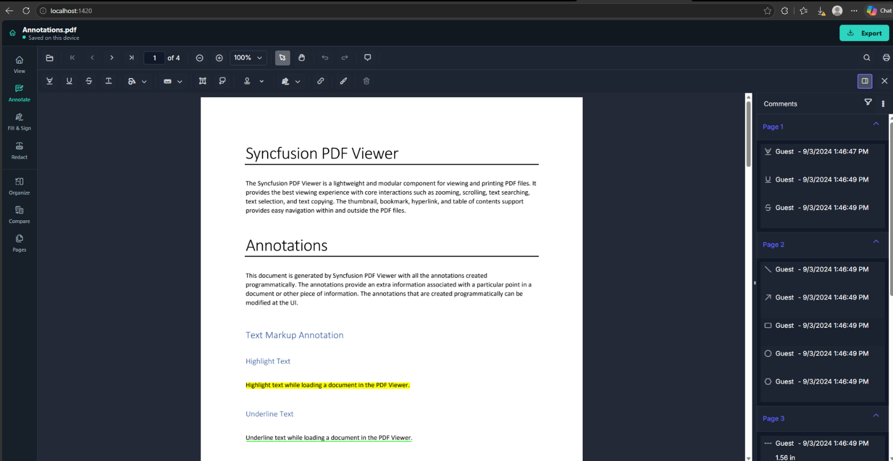
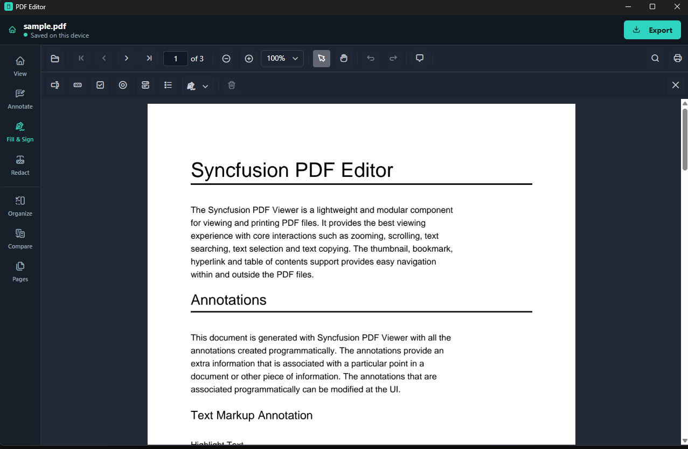
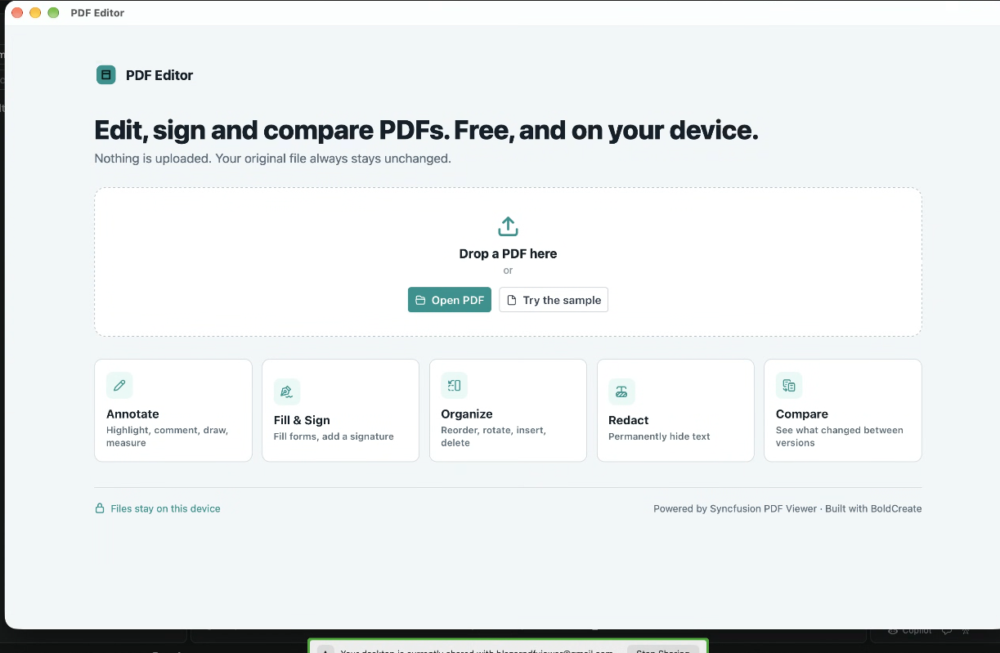
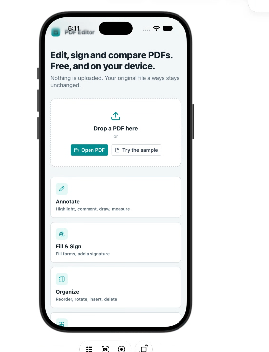

# Syncfusion Cross-Platform PDF Editor

Cross-Platform PDF Editor is a modern PDF application built with **Syncfusion React PDF Viewer**, **Tauri**, and **BoldCreate**. The application supports deployment as a browser-based web application and as native applications for **Windows**, **macOS**, and **Android** from a shared codebase.

> For the detailed product specification, see `docs/SPEC.md`.

---

# Quick Start

If you are new to the technologies used in this project, review the following guides before setup:

- Syncfusion React PDF Viewer Getting Started: https://help.syncfusion.com/document-processing/pdf/pdf-viewer/react/getting-started
- BoldCreate Quick Start: https://docs.boldcreate.ai/getting-started/quick-start
- What is Tauri?: https://v2.tauri.app/start/

Clone the repository and start the application locally:

```bash
git clone <repository-url>
cd cross-platform-pdf-editor
npm install
cp .env.example .env
npm run dev
```

Open the application at:

```text
http://localhost:1420
```

---

# Features

- PDF viewing and navigation
- Annotation support
- Form designing and filling
- Redaction support
- Organize PDF pages support
- Compare PDF documents support
- Export and import PDF data
- Cross-platform deployment
- Native desktop integration through Tauri
- Android application support
- Shared React codebase across all platforms

---

# Project Structure

```text
cross-platform-pdf-editor/
├── docs/
│   └── SPEC.md
├── public/
│   ├── ej2-pdfviewer-lib/
│   ├── sample.pdf
│   └── sample-v2.pdf
├── scripts/
│   ├── copy-viewer-assets.mjs
│   └── make-samples.py
├── src/
└── src-tauri/
```

---

# Sample Screenshots

> Replace the placeholders below with actual screenshots.

## Browser Application


## Windows Application


## macOS Application


## iOS Application


---

# Prerequisites

## Common Requirements

| Component | Version |
|-----------|---------|
| Node.js | 22 LTS (Minimum 20.19) |
| Rust | 1.85 or later |
| NPM | Latest |

## Technology References

- BoldCreate Quick Start: https://docs.boldcreate.ai/getting-started/quick-start
- Syncfusion React PDF Viewer Getting Started: https://help.syncfusion.com/document-processing/pdf/pdf-viewer/react/getting-started
- Tauri Documentation: https://v2.tauri.app/start/
- Tauri Prerequisites: https://v2.tauri.app/start/prerequisites/

## Platform Requirements

### Windows
- Visual Studio 2022 Build Tools
- Desktop Development with C++ workload
- Microsoft Edge WebView2 Runtime

### macOS
- Xcode
- Xcode Command Line Tools

### Android
- Android Studio
- Android SDK
- Android SDK Command Line Tools
- Android NDK
- Java 17

---

# Initial Setup

```bash
npm install
cp .env.example .env
npm run build
```

Configure if needed:

```env
VITE_SYNCFUSION_LICENSE=YOUR_LICENSE_KEY
```

---

# Syncfusion PDFium Assets

`npm install` automatically runs:

```bash
scripts/copy-viewer-assets.mjs
```

and copies:

```text
pdfium.js
pdfium.wasm
```

into:

```text
public/ej2-pdfviewer-lib/
```

If required, manually download the assets from:

https://cdn.syncfusion.com/ej2/35.1.40/dist/ej2-pdfviewer-lib/

---

# Running in Browser (Web)

```bash
npm run dev
```

Build:

```bash
npm run build
```

Preview:

```bash
npm run preview
```

---

# Running on Windows

```bash
npm run desktop:dev
```

Build desktop package:

```bash
npm run desktop:build
```

Output:

```text
src-tauri/target/release/bundle/
```

---

# Running on macOS

Install Xcode tools:

```bash
xcode-select --install
```

Run:

```bash
npm run desktop:dev
```

Build:

```bash
npm run desktop:build
```

---

# Running on Android

Configure environment variables:

```bash
export ANDROID_HOME=$HOME/Android/Sdk
export ANDROID_SDK_ROOT=$ANDROID_HOME
export NDK_HOME=$ANDROID_HOME/ndk/29.0.13846066
```

Initialize Android:

```bash
npm run android:init
```

Run:

```bash
npm run android:dev
```

Build APK:

```bash
npm run android:build
```

Output:

```text
src-tauri/gen/android/app/build/outputs/apk/
```

---

# Available Scripts

| Command | Description |
|----------|-------------|
| npm run dev | Start Vite development server |
| npm run build | Build web application |
| npm run preview | Preview production build |
| npm run desktop:dev | Run Tauri desktop application |
| npm run desktop:build | Build native desktop application |
| npm run android:init | Initialize Android project |
| npm run android:dev | Run Android application |
| npm run android:build | Build Android APK |
| npm run ios:init | Initialize iOS project |
| npm run ios:dev | Run iOS application |
| npm run ios:build | Build iOS application |

---

# Configuration

All Tauri-specific settings are maintained in:

```text
src-tauri/tauri.conf.json
```

---

# Open With Support

Windows, Linux, and macOS use:

```json
bundle.fileAssociations
```

macOS uses:

```rust
RunEvent::Opened
```

to forward PDF open requests through the `open-file` event.

Android and iOS document association support is planned for a future release.

---

# Licensing

```env
VITE_SYNCFUSION_LICENSE
```

Registered through:

```text
src/license.ts
```

Disable telemetry:

```env
VITE_DISABLE_TELEMETRY=true
```

---

# References

- BoldCreate Quick Start: https://docs.boldcreate.ai/getting-started/quick-start
- Syncfusion React PDF Viewer Getting Started: https://help.syncfusion.com/document-processing/pdf/pdf-viewer/react/getting-started
- Tauri Documentation: https://v2.tauri.app/start/
- Tauri Prerequisites: https://v2.tauri.app/start/prerequisites/